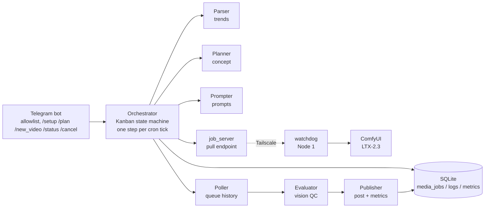
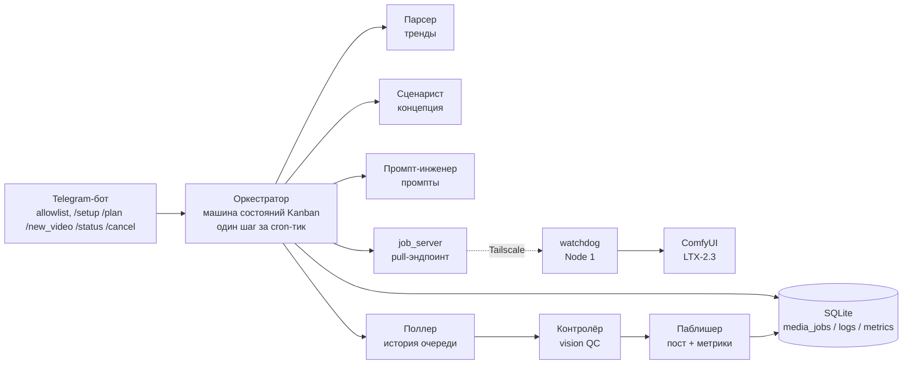

# Content Factory — Local Production Prototype

> An autonomous, agent-driven content factory: from trend signals to publishable short-form video and photo posts, operated from a single Telegram chat.

[]()
[]()
[]()
[]()

A **local production prototype** of an agent-based content factory. The system takes raw trend signals, turns them into content concepts and render prompts, generates short-form media on a remote GPU node running ComfyUI, quality-checks the output, and publishes it through an external posting CLI. All state is kept in SQLite; all configuration lives in `.env`; every step runs as a short-lived, event-driven process.

## Overview

The factory is split across two machines:

- **Node 2 — "The Brain"** (macOS, this repository): agent orchestration, Telegram UI, LLM pool with automatic fallback, SQLite operational memory, trend parsing, planning, prompting, quality control, publishing and metrics.
- **Node 1 — Renderer** (Windows GPU PC): ComfyUI with approved LTX-2.3 video workflows, fed by a small pull-based watchdog over a private Tailscale network.

The user interacts with the factory through a single Telegram bot with an allowlist of two admin IDs: `/setup`, `/plan`, `/new_video`, `/status`, `/cancel`.

## Problem

Producing a consistent stream of short-form content is repetitive and slow: research trends, write concepts, craft prompts, render, check for defects, post, measure. Doing it manually does not scale, and fully autonomous pipelines are usually fragile — long-running loops burn tokens, fail silently, or leak secrets into code.

## Solution

A **deterministic state machine** instead of an always-on agent loop. Each cron tick launches a clean process that moves every job at most **one step** along a Kanban board stored in SQLite, then exits. Failures are isolated per job and retried on the next tick. Models are accessed only through a unified client with a provider fallback chain, so the pipeline keeps working when a cloud API is rate-limited or down.

```
new → planned → ready_for_render → generating → done → approved → published
        (terminal states: published / failed / error)
```

## Key capabilities

- **Trend parsing with fallback chain** — `core.parser` collects trend signals from the Scrape Creators API, falling back to `crawl4ai` and Jina Reader; results are normalized into one schema.
- **Concept planning** — `core.planner` turns a raw trend into a viral concept and script for a short-form post.
- **Prompt engineering with gates** — `core.prompter` produces two technical English prompts (photo and video) for ComfyUI; empty or invalid LLM output is rejected and retried on the next tick.
- **Reliable GPU hand-off** — a pull-based `job_server` / `node1_watchdog` pair (stdlib HTTP over Tailscale) delivers approved API workflows to the renderer, bypassing Windows firewall issues that broke SMB-based approaches.
- **Active result polling** — `core.poller` checks ComfyUI queue history on each cron tick (no webhook server required on Node 1) and advances `generating → done/error`.
- **Vision quality control** — `core.evaluator` sends generated images to a vision model and demands a strict JSON verdict; a bounded regeneration loop (safety valve: `EVALUATOR_MAX_RETRIES`) rejects defective renders. Video files (MP4) are auto-approved since the vision model does not accept them.
- **Publishing and metrics** — `core.publisher` invokes an external autopost CLI as an isolated syscall and collects multi-level post metrics (1d / 1w / 1m) into SQLite.
- **Resilient LLM access** — `core.llm` rotates providers (OpenRouter → OpenAI → Anthropic) and falls back to a local LM Studio endpoint when all cloud APIs fail; optional Headroom context compression.
- **Preflight acceptance harness** — `scripts/acceptance_harness.py` verifies Tailscale auth, Node 1 reachability, ComfyUI system stats and required node types before render cycles.

## Architecture



**Node 2** (this repo): Telegram transport (`core.telegram_gateway`, one-shot, no poll loop) → orchestrator tick (`python -m core.orchestrator`, optional `--trigger <job_id>` for a single manual job) → sub-agents. **Node 1**: `scripts/node1_watchdog.py` polls the job server every 2 s, submits the workflow to local ComfyUI, and deletes the job file only after a successful submit.

## Tech stack

| Area | Choice |
|---|---|
| Language | Python 3.10+ (strict typing, `mypy`) |
| Agent shell | Hermes Agent — clean event/cron sessions |
| LLM access | Unified client via OpenAI SDK: OpenRouter / OpenAI / Anthropic / local LM Studio |
| Config | `pydantic-settings`, `.env` only — no hardcoded keys or paths |
| Storage | SQLite (stdlib `sqlite3`, no ORM) + Graphify knowledge graph |
| Rendering | ComfyUI + approved LTX-2.3 workflows, `cli-anything-comfyui` |
| Transport | Tailscale private network |
| UI | Telegram Bot API |
| Tooling | `pytest` (TDD specs in `docs/testing/`), `mypy` |

## Project status

**Prototype.** MVP milestones 01–07 are implemented and covered by tests (Telegram shell, brand profile, `/new_video` flow, queue and recovery, weekly plan, scheduled generation, operations durability). Milestone 08 — the two-node acceptance run (Mac Node 2 + Windows Node 1) with recorded evidence — is in progress.

## My contribution

Designed and implemented the system architecture: the agent orchestration (Kanban state machine over SQLite with the clean-context tick model), the unified LLM client with provider fallback, the pull-based Node 1 render pipeline (job server, watchdog, active poller), the vision quality gate, and the Telegram operator shell.

## Quick start

Requirements: Python 3.10+, a Tailscale-connected render node (Windows) with ComfyUI, and a Telegram bot token.

```bash
git clone git@github.com:atrshncv-design/Content-Factory-IVAN-LOCAL.git
cd Content-Factory-IVAN-LOCAL
python3 -m venv .venv && source .venv/bin/activate
pip install -r requirements.txt
cp .env.example .env          # fill in endpoints and keys (no hardcoded secrets)
pytest                        # test suite
mypy core tests               # strict typing gate
```

Run a production tick (launchd example in `ops/macos/`):

```bash
python -m core.telegram_gateway tick   # deliver pending Telegram commands
python -m core.orchestrator            # one Kanban step per job
```

Manual single-job evaluation: `python -m core.orchestrator --trigger <job_id>`.

Node 1 setup: `scripts/job_server.py` runs on Node 2 (Tailscale interface); `scripts/node1_watchdog.py` runs on the Windows render node (`ops/windows/start_node1.cmd`).

## Configuration

All settings are read from `.env` (template: `.env.example`). Main groups:

- **LLM pool** — `OPENROUTER_API_KEY` / `OPENAI_API_KEY` / `ANTHROPIC_API_KEY` and per-provider model names; `LMSTUDIO_BASE_URL` / `LMSTUDIO_MODEL` for the local fallback.
- **Storage** — `DB_PATH` (SQLite file).
- **Parser** — `SCRAPE_CREATORS_API_KEY`, `SCRAPE_CREATORS_BASE_URL`.
- **Node 1 link** — `COMFYUI_SERVER_URL`, `SHARED_FOLDER`, `TAILSCALE_PROXY_*`, `JOB_SERVER_HOST` / `JOB_SERVER_PORT`, `JOBS_DIR`.
- **Telegram** — `TELEGRAM_BOT_TOKEN`, `TELEGRAM_CHAT_ID`, `TELEGRAM_ADMIN_ID_1` / `TELEGRAM_ADMIN_ID_2`, `TELEGRAM_MVP_DIR`.
- **Quality control** — `EVALUATOR_MAX_RETRIES` (regeneration safety valve).
- **Publisher** — `AUTOPOST_COMMAND` (external posting CLI).
- **Orchestrator** — `COMFYUI_COMMAND`, `COMFYUI_WORKFLOW_TEMPLATE`, `COMFYUI_WORKFLOW_DIR`, `COMFYUI_WORKFLOW_SHA256`, `CONTENT_NICHE`.

## Limitations

- Single-GPU render queue — one render at a time.
- Results are picked up by polling on the next cron tick; no webhook push from Node 1 (latency up to one tick).
- Video files bypass vision QC (auto-approved); only static images get the strict review.
- No intra-tick retries: a failed sub-agent step is retried on the next tick.
- Telegram shell is restricted to two admin IDs.
- The Hermes runtime currently lives on the macOS node only; the client-side Windows deployment is out of MVP scope.
- Acceptance evidence for the two-node loop (MVP-08) is still being collected.

## Roadmap

- Finish MVP-08: two confirmed end-to-end cycles on Mac Node 2 + Windows Node 1 with recorded acceptance evidence.
- Frame-based QC for rendered video (ffprobe/vision), closing the video auto-approve gap.
- Full auto-publishing scheduling and guaranteed trend scraping.
- Multi-job render queue beyond a single GPU.

---

# Content Factory — локальный производственный прототип

> Автономный контент-завод на агентах: от сигналов трендов до готовых к публикации коротких видео и фото, управляемый из одного Telegram-чата.

[]()
[]()
[]()
[]()

**Локальный производственный прототип** контент-завода на агентах. Система принимает сырые сигналы трендов, превращает их в концепции и промпты, рендерит короткий медиа-контент на удалённом GPU-узле с ComfyUI, проверяет качество результата и публикует его через внешнюю CLI-утилиту автопостинга. Всё состояние хранится в SQLite, вся конфигурация — в `.env`, каждый шаг выполняется коротким событийным процессом.

## Обзор

Завод разделён на две машины:

- **Node 2 — «мозг»** (macOS, этот репозиторий): оркестрация агентов, Telegram-интерфейс, пул LLM с автоматическим fallback, операционная память в SQLite, парсинг трендов, сценарии, промпты, контроль качества, публикация и метрики.
- **Node 1 — рендер-узел** (Windows GPU-ПК): ComfyUI с утверждёнными LTX-2.3 workflow, питается лёгким watchdog'ом по pull-модели через приватную сеть Tailscale.

Пользователь работает через одного Telegram-бота с allowlist из двух администраторов: `/setup`, `/plan`, `/new_video`, `/status`, `/cancel`.

## Проблема

Регулярный выпуск короткого контента — рутинный и медленный процесс: исследование трендов, концепции, промпты, рендер, проверка брака, публикация, аналитика. Вручную это не масштабируется, а полностью автономные конвейеры обычно хрупкие: вечные циклы жгут токены, падают молча или протекают секретами в код.

## Решение

**Детерминированная машина состояний** вместо бесконечного цикла агента. Каждый cron-тик запускает чистый процесс, который двигает каждое задание максимум на **один шаг** по Kanban-доске в SQLite и завершается. Сбои изолируются по заданию и повторяются на следующем тике. Модели доступны только через единый клиент с цепочкой fallback, поэтому конвейер продолжает работать при лимитах и отказах облачных API.

```
new → planned → ready_for_render → generating → done → approved → published
        (терминальные состояния: published / failed / error)
```

## Ключевые возможности

- **Парсинг трендов с fallback-цепочкой** — `core.parser` собирает сигналы через Scrape Creators API, при недоступности — `crawl4ai` и Jina Reader; результаты нормализуются в единую схему.
- **Сценарии** — `core.planner` превращает сырой тренд в виральную концепцию и сценарий короткого поста.
- **Промпты с гейтами** — `core.prompter` генерирует два технических промпта на английском (фото и видео) для ComfyUI; пустой или невалидный ответ LLM отклоняется и повторяется на следующем тике.
- **Надёжная передача на GPU** — pull-пара `job_server` / `node1_watchdog` (stdlib HTTP поверх Tailscale) доставляет утверждённые API-workflow на рендер-узел, обходя ограничения Windows-брандмауэра, из-за которых не работал SMB-подход.
- **Активный поллер** — `core.poller` на каждом cron-тике опрашивает историю очереди ComfyUI (webhook на Node 1 не нужен) и переводит `generating → done/error`.
- **Vision-контроль качества** — `core.evaluator` отправляет сгенерированные изображения vision-модели и требует строгий JSON-вердикт; ограниченный цикл перегенерации (предохранитель: `EVALUATOR_MAX_RETRIES`) отбраковывает дефектный рендер. Видео (MP4) проходят auto-approve — vision-модель их не принимает.
- **Публикация и метрики** — `core.publisher` вызывает внешнюю CLI автопостинга как изолированный syscall и собирает многоуровневые метрики постов (1d / 1w / 1m) в SQLite.
- **Отказоустойчивый доступ к LLM** — `core.llm` ротирует провайдеров (OpenRouter → OpenAI → Anthropic) и уходит на локальную LM Studio при отказе всех облачных API; опциональное сжатие контекста через Headroom.
- **Preflight-приёмка** — `scripts/acceptance_harness.py` проверяет авторизацию Tailscale, доступность Node 1, системную статистику ComfyUI и наличие нужных типов нод.

## Архитектура



**Node 2** (этот репозиторий): Telegram-транспорт (`core.telegram_gateway`, одноразовый, без poll-loop) → тик оркестратора (`python -m core.orchestrator`, опция `--trigger <job_id>` для ручной обработки одного задания) → субагенты. **Node 1**: `scripts/node1_watchdog.py` раз в 2 секунды опрашивает job-сервер, отправляет workflow в локальный ComfyUI и удаляет job-файл только после успешного submit.

## Технологический стек

| Область | Выбор |
|---|---|
| Язык | Python 3.10+ (строгая типизация, `mypy`) |
| Агентная оболочка | Hermes Agent — чистые event/cron-сессии |
| Доступ к LLM | Единый клиент на OpenAI SDK: OpenRouter / OpenAI / Anthropic / локальная LM Studio |
| Конфигурация | `pydantic-settings`, только `.env` — без хардкода ключей и путей |
| Хранилище | SQLite (stdlib `sqlite3`, без ORM) + граф знаний Graphify |
| Рендер | ComfyUI + утверждённые LTX-2.3 workflow, `cli-anything-comfyui` |
| Транспорт | Приватная сеть Tailscale |
| UI | Telegram Bot API |
| Инструменты | `pytest` (TDD-спеки в `docs/testing/`), `mypy` |

## Статус проекта

**Prototype.** Вехи MVP 01–07 реализованы и покрыты тестами (Telegram-оболочка, профиль бренда, флоу `/new_video`, очередь и восстановление, недельный план, генерация по расписанию, отказоустойчивость эксплуатации). Веха 08 — приёмочный прогон двухузлового контура (Mac Node 2 + Windows Node 1) с фиксацией evidence — в работе.

## Мой вклад

Спроектировал и реализовал архитектуру системы: оркестрацию агентов (машина состояний Kanban поверх SQLite с моделью чистых тиков), единый LLM-клиент с fallback-цепочкой провайдеров, pull-конвейер рендера на Node 1 (job-сервер, watchdog, активный поллер), vision-гейт качества и Telegram-оболочку оператора.

## Быстрый старт

Требования: Python 3.10+, рендер-узел (Windows) с ComfyUI в сети Tailscale, токен Telegram-бота.

```bash
git clone git@github.com:atrshncv-design/Content-Factory-IVAN-LOCAL.git
cd Content-Factory-IVAN-LOCAL
python3 -m venv .venv && source .venv/bin/activate
pip install -r requirements.txt
cp .env.example .env          # заполнить эндпоинты и ключи (секреты — только здесь)
pytest                        # тестовый набор
mypy core tests               # гейт строгой типизации
```

Прогон производственного тика (пример launchd — в `ops/macos/`):

```bash
python -m core.telegram_gateway tick   # доставка накопленных Telegram-команд
python -m core.orchestrator            # один шаг Kanban на задание
```

Ручная обработка одного задания: `python -m core.orchestrator --trigger <job_id>`.

Настройка Node 1: `scripts/job_server.py` запускается на Node 2 (интерфейс Tailscale); `scripts/node1_watchdog.py` — на Windows-узле (`ops/windows/start_node1.cmd`).

## Конфигурация

Все настройки читаются из `.env` (шаблон — `.env.example`). Основные группы:

- **Пул LLM** — `OPENROUTER_API_KEY` / `OPENAI_API_KEY` / `ANTHROPIC_API_KEY` и имена моделей; `LMSTUDIO_BASE_URL` / `LMSTUDIO_MODEL` для локального fallback.
- **Хранилище** — `DB_PATH` (файл SQLite).
- **Парсер** — `SCRAPE_CREATORS_API_KEY`, `SCRAPE_CREATORS_BASE_URL`.
- **Связь с Node 1** — `COMFYUI_SERVER_URL`, `SHARED_FOLDER`, `TAILSCALE_PROXY_*`, `JOB_SERVER_HOST` / `JOB_SERVER_PORT`, `JOBS_DIR`.
- **Telegram** — `TELEGRAM_BOT_TOKEN`, `TELEGRAM_CHAT_ID`, `TELEGRAM_ADMIN_ID_1` / `TELEGRAM_ADMIN_ID_2`, `TELEGRAM_MVP_DIR`.
- **Контроль качества** — `EVALUATOR_MAX_RETRIES` (предохранитель перегенерации).
- **Паблишер** — `AUTOPOST_COMMAND` (внешняя CLI автопостинга).
- **Оркестратор** — `COMFYUI_COMMAND`, `COMFYUI_WORKFLOW_TEMPLATE`, `COMFYUI_WORKFLOW_DIR`, `COMFYUI_WORKFLOW_SHA256`, `CONTENT_NICHE`.

## Ограничения

- Очередь одного GPU-рендера — одновременно выполняется один рендер.
- Результаты подхватываются поллером на следующем cron-тике; webhook-push с Node 1 отсутствует (задержка до одного тика).
- Видео проходят QC в обход vision-модели (auto-approve); строгая проверка — только для статичных изображений.
- Внутри тика ретраев нет: упавший шаг субагента повторяется на следующем тике.
- Telegram-оболочка ограничена двумя ID администраторов.
- Hermes-рантайм пока живёт только на macOS-узле; установка на Windows-ПК клиента вне рамок MVP.
- Evidence приёмки двухузлового контура (MVP-08) ещё собирается.

## Дорожная карта

- Завершить MVP-08: два подтверждённых сквозных цикла на Mac Node 2 + Windows Node 1 с зафиксированными evidence приёмки.
- Покадровый QC рендеренного видео (ffprobe/vision) — закрыть разрыв auto-approve.
- Полное планирование автопубликации и гарантированный скрейпинг трендов.
- Очередь из нескольких рендер-задач за пределами одного GPU.

## License / Лицензия

Released under the MIT License. See [LICENSE](LICENSE).
Проект распространяется по лицензии MIT. См. [LICENSE](LICENSE).
